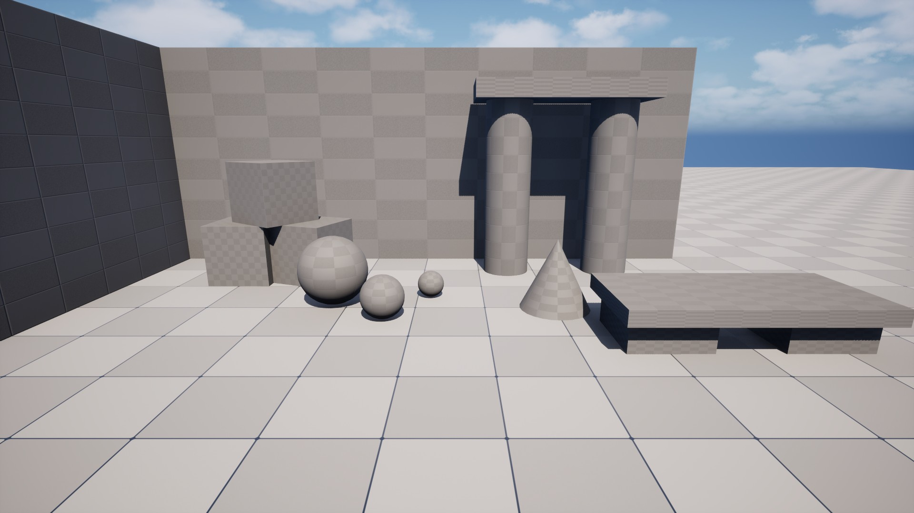
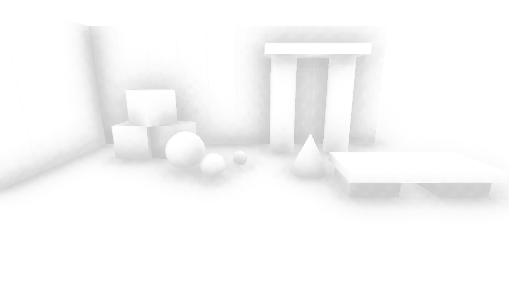
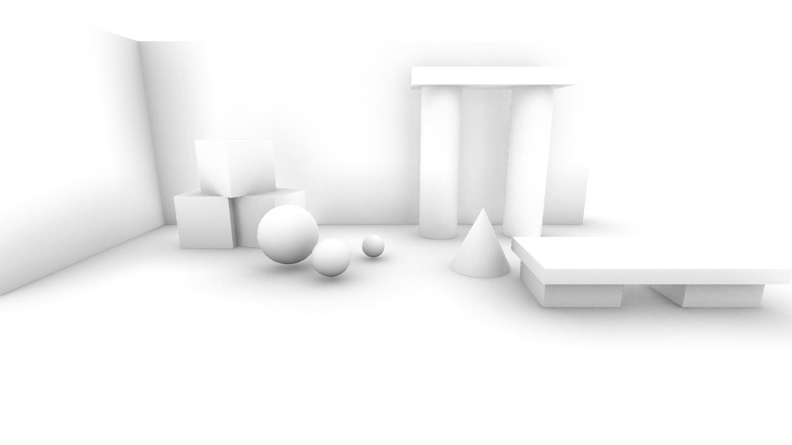

# CORTAO for Unreal Engine

**CORTAO** (Circular Occluder Ray-Traced Ambient Occlusion) is a physically based screen space ambient occlusion
technique by **Daniel Isheden**: <https://github.com/theagentd/CORTAO> (MIT). Its README explains the algorithm,
compares it with GTAO and has the reference benchmarks; read it first.

This repository is an Unreal Engine plugin that runs CORTAO in place of the engine's own screen space ambient
occlusion, **without an engine fork**. It was written by [Ananta Studio](https://github.com/Ananta-Studio) for a
game in development and is published in the hope that it saves someone else the port. It is MIT licensed, like
CORTAO itself.

| | |
| --- | --- |
| Plugin version | 1.0.0 (beta) |
| CORTAO version | reference implementation 1.0.3 |
| Unreal Engine | 5.8 (built and run on 5.8.3, the launcher build) |
| Platform | Windows, Direct3D 12, Shader Model 6. Nothing else was tested, see [What was tested](#what-was-tested) |

> **Read this before installing.** The plugin renders from the engine's *global illumination plugin* hook, so it
> only works for views whose Global Illumination method is **Plugin**. That means **no Lumen global illumination**
> in the same view. It is a replacement for SSAO in projects that light with a sky light, baked lighting or
> another global illumination plugin, not an addition to Lumen. Details in
> [How it sits beside the engine's ambient occlusion](#how-it-sits-beside-the-engines-ambient-occlusion).



| Engine SSAO (engine defaults) | CORTAO (plugin defaults, 16 samples) |
| --- | --- |
|  |  |

*The Ambient Occlusion buffer view of the same scene in a blank UE 5.8 project (the engine's template map plus
basic shapes), 1920x1080. Unretouched screenshots; `Images/cortao_ao_no_temporal.png` is the CORTAO view with
`r.CORTAO.Temporal 0`.*

## Contents

- [What this port adds](#what-this-port-adds)
- [What was tested](#what-was-tested)
- [Install](#install)
- [Switch it on](#switch-it-on)
- [How it sits beside the engine's ambient occlusion](#how-it-sits-beside-the-engines-ambient-occlusion)
- [Console variables](#console-variables)
- [Foliage](#foliage)
- [Host hooks in CORTAOMainPass.ush](#host-hooks-in-cortaomainpassush)
- [Known limitations](#known-limitations)
- [Performance](#performance)
- [How the port differs from the reference](#how-the-port-differs-from-the-reference)
- [Updating from upstream](#updating-from-upstream)
- [Troubleshooting](#troubleshooting)
- [Changelog](#changelog)
- [Credits and licence](#credits-and-licence)

## What this port adds

CORTAO's reference implementation is a set of shader headers with callbacks that the host engine fills in. This
plugin is that host side for Unreal Engine:

- **The three CORTAO passes as RDG compute passes** (prepass, main pass, filter pass), driven from
  `FGlobalIlluminationPluginDelegates::RenderDiffuseIndirectLight`. The result is written into the engine's own
  `ScreenSpaceAO` texture, so the indirect lighting composite, the sky light and reflections pick it up exactly as
  they pick up the engine's SSAO. Nothing in the engine is modified.
- **A temporal accumulation pass** (`r.CORTAO.Temporal`). CORTAO ships none and leaves its per-frame noise to the
  host's temporal anti-aliasing; this pass reprojects last frame's occlusion (camera motion and the velocity
  buffer), drops it where the depth no longer matches, and blends. It makes the AO buffer stable on its own, also
  with FXAA or no anti-aliasing.
- **Two sources for the surface normal**: the GBuffer's (normal maps included, CORTAO's recommendation) or one
  rebuilt from the depth buffer (`r.CORTAO.DepthNormals`).
- **Foliage handling.** Stylised grass and leaf cards are lit with normals that do not match their geometry, which
  makes CORTAO (correctly, by its own model) darken and stipple them. The port flags foliage pixels and treats
  them differently; see [Foliage](#foliage).
- **Strength and power** on the result (`r.CORTAO.Intensity`, `r.CORTAO.Power`) for art direction.
- Sample count permutations for 4, 6, 8, 12, 16, 24 and 32 samples, the small and large filter, and the 16-ray
  occluder lookup table compiled into the module.

What it does **not** use from CORTAO: bent normals (only the occlusion term is output) and the bent normal lookup
table.

## What was tested

Tested by the authors:

- Unreal Engine 5.8.3 (launcher build), Windows 11, Direct3D 12, Shader Model 6, NVIDIA GeForce RTX 5070 Ti.
- `RunUAT BuildPlugin` for Win64 against the installed 5.8 engine: the editor target and the game target in
  Development and Shipping all compile.
- A blank C++ project with nothing in it but this plugin and a test scene, run uncooked with `-game`: the
  shaders compile, CORTAO renders, the configuration in [Switch it on](#switch-it-on) works from the ini alone.
  The screenshots and the numbers in [Performance](#performance) come from that project.
- One game project in development (deferred renderer, Substrate off, ray tracing off, another global illumination
  plugin on the same hook, TSR and DLSS): editor viewports, Play In Editor, and the foliage handling on stylised
  grass.

**Not tested**, so assume it does not work until you have checked:

- Any engine version other than 5.8. The module includes the renderer's private headers (`FViewInfo`,
  `FSceneTextures`, the delegate); these change between versions.
- Direct3D 11, Vulkan, Shader Model 5, Linux, Mac, consoles, mobile. The modules are limited to Win64 in the
  `.uplugin` (`PlatformAllowList`) for this reason; remove the entry to try another platform.
- Packaged (cooked) builds of the blank project. The plugin's game-target code compiles, but a cook was not run
  on it.
- Substrate materials (both test projects have Substrate off).
- VR / stereo rendering, split screen, orthographic cameras (orthographic views are skipped on purpose).
- The forward renderer (there is no GBuffer and no hook there; it cannot work).
- AMD and Intel GPUs.

Reports and pull requests for any of these are welcome.

## Install

The plugin is source only; your project must be a C++ project (or you must be able to compile plugins).

1. Copy or clone this repository into your project as `Plugins/CORTAO`:

   ```
   cd <YourProject>/Plugins
   git clone https://github.com/Ananta-Studio/cortao-ue.git CORTAO
   ```

2. Enable it: add it to your `.uproject`, or tick **CORTAO Ambient Occlusion** in Edit > Plugins (category
   Rendering).

   ```json
   "Plugins": [
       { "Name": "CORTAO", "Enabled": true }
   ]
   ```

3. Rebuild the project (the editor will offer to, or build the editor target from your IDE). The first start
   compiles the plugin's global shaders.

To package the plugin on its own: `RunUAT BuildPlugin -Plugin=<path>/CORTAO.uplugin -Package=<out dir>
-TargetPlatforms=Win64`.

## Switch it on

CORTAO is **off** by default (`r.CORTAO 0`). Three things have to be true for it to render:

1. **The view's Global Illumination method is Plugin.** Project Settings > Engine > Rendering > Global
   Illumination > Dynamic Global Illumination Method = *Plugin*, or the same setting in a post-process volume.
2. **The engine's SSAO runs**, because CORTAO writes into the texture that pass creates. Keep it at its cheapest
   level; its own result is overwritten.
3. **`r.CORTAO` is 1.**

For a whole project, put this in `Config/DefaultEngine.ini`:

```ini
[/Script/Engine.RendererSettings]
r.DynamicGlobalIlluminationMethod=3

[SystemSettings]
r.CORTAO=1
; The engine's SSAO only has to exist: one level, lowest shader quality.
r.AmbientOcclusionLevels=1
r.AmbientOcclusionMaxQuality=0
```

`[SystemSettings]` outranks the scalability groups, which is what you want here: the *Low* post-processing
quality level sets `r.AmbientOcclusionLevels 0`, and with no engine SSAO there is no texture for CORTAO to write.

To try it in a running editor first, set the Global Illumination method as above and type into the console:

```
r.AmbientOcclusionLevels 1
r.AmbientOcclusionMaxQuality 0
r.CORTAO 1
```

To look at the result alone: the viewport's View Mode > Buffer Visualization > **Ambient Occlusion**. A game that
lets the player choose should set the same console variables from its settings code (and set `r.CORTAO 0` and
restore the two engine variables when the player picks another method).

If nothing changes, see [Troubleshooting](#troubleshooting): the plugin writes a line to the log (category
`LogCORTAO`) when it is switched on but cannot render.

## How it sits beside the engine's ambient occlusion

| Engine feature | With CORTAO on |
| --- | --- |
| **SSAO** (`r.AmbientOcclusion.Method 0`) | Must stay enabled; CORTAO overwrites its output inside the view rectangle. Run it with `r.AmbientOcclusionLevels 1` and `r.AmbientOcclusionMaxQuality 0`. The post-process volume's AO *Intensity* must stay above 0 and *Radius* at 0.1 or more (the engine skips the pass otherwise); the other AO settings of the volume (power, bias, fade, static fraction...) no longer do anything. Use `r.CORTAO.Intensity`, `r.CORTAO.Power` and `r.CORTAO.Radius`. |
| **GTAO** (`r.AmbientOcclusion.Method 1`) | Not tested. Leave the method at 0; GTAO would cost more only to be overwritten. |
| **Ray traced AO** | Turn it off. While it is on the engine does not run SSAO and CORTAO skips the view. |
| **Lumen global illumination** | Cannot be combined: the hook only fires when the method is Plugin. Lumen *reflections* can still be chosen separately, but this was not tested. |
| **Global illumination method None** | CORTAO does not render (the hook does not fire). Use *Plugin* instead. With no global illumination plugin installed the Plugin method adds no indirect light of its own; in the test scene the lit image looked the same as with None (compared by eye and by region averages, not pixel for pixel: the sky has moving clouds). |
| **Other global illumination plugins** | They use the same delegate and run beside CORTAO. This is how the plugin is used in the authors' game. |
| **Material ambient occlusion** (the material's AO pin) | Unaffected. The engine multiplies it in separately. |
| **Ambient occlusion decals** | Lost. They are drawn into `ScreenSpaceAO` before CORTAO overwrites it. |
| **Distance field AO** | Independent of this plugin. |

Where the result goes is the engine's business, not the plugin's: screen space AO darkens the sky light, the
indirect/static lighting and reflections. The engine also applies it to the **direct** light of lights that cast
no shadows (`DeferredLightingCommon.ush`), so an unshadowed point light shows CORTAO at full strength. That is
engine behaviour, and the same with its own SSAO.

## Console variables

All of them can be changed at run time. Where CORTAO has a parameter of the same meaning, the default is CORTAO
1.0.3's recommendation; the rest are marked as the port's.

### Main

| Variable | Default | What it does |
| --- | --- | --- |
| `r.CORTAO` | 0 | 1 switches CORTAO on. |
| `r.CORTAO.Samples` | 16 | Occluder samples per pixel: 4, 6, 8, 12, 16, 24 or 32 (other values snap to the nearest). The main quality/cost setting; cost grows about linearly. CORTAO's names: 4 Minimal, 6 Very Low, 8 Low, 12 Medium, 16 High, 24 Very High, 32 Ultra. |
| `r.CORTAO.Radius` | 150 | World-space radius of the occlusion search, in cm. Port's choice for Unreal's units. |
| `r.CORTAO.ScreenRadius` | 0.2 | Largest search radius on screen as a fraction of the screen height (CORTAO recommends 0.1 to 0.25). Stops close-up surfaces from sampling the whole screen. |
| `r.CORTAO.MipBias` | -4 | Bias on the depth mip the samples read. Lower is sharper and slower (cache misses), higher is blurrier and faster. |
| `r.CORTAO.SlopeCompensation` | 4 | Largest growth of an occluder seen at a grazing angle; 1 disables it. Higher darkens creases on slanted surfaces more. |
| `r.CORTAO.BackfaceThreshold` | 0.5 | How much an occluder must face away to count as a backface. |
| `r.CORTAO.BackfaceBoost` | 0 | 0..1: how much backface occluders are enlarged to stop light leaking through thin walls. |
| `r.CORTAO.Intensity` | 1 | 0..1: blend from no occlusion to CORTAO's full, physically based result. Port's addition. |
| `r.CORTAO.Power` | 1 | Exponent on the occlusion; above 1 darkens and adds contrast. Port's addition (the way CORTAO's README suggests styling the result). |
| `r.CORTAO.DepthNormals` | 0 | 0: normals from the GBuffer (normal maps included). 1: rebuilt from the depth buffer (geometry only). Port's addition. |

### Filtering

| Variable | Default | What it does |
| --- | --- | --- |
| `r.CORTAO.Filter` | 2 | CORTAO's spatial filter ahead of the temporal one. 0 off, 1 small, 2 large. |
| `r.CORTAO.FilterDepthSensitivity` | 512 | How strongly the filter stops at depth edges. |
| `r.CORTAO.FilterNormalSensitivity` | 128 | How strongly the filter stops at normal edges. Lower values blur across more of a curved or normal-mapped surface. |
| `r.CORTAO.Temporal` | 1 | The port's temporal accumulation. 0 off (leave the noise to TSR/TAA/DLSS, as upstream does), 1 on. Turn it on if the project can run without a temporal anti-aliaser. |
| `r.CORTAO.TemporalWeight` | 0.9 | 0..0.98: share of last frame's accumulated occlusion kept each frame. Higher is smoother and slower to react. |
| `r.CORTAO.TemporalDepthTolerance` | 0.05 | Relative depth difference above which last frame's value is thrown away (disocclusion). |
| `r.CORTAO.TemporalClamp` | 1 | Where the depth test fails, keep last frame's value clamped into this frame's 3x3 range instead of dropping it. 0 off, 1 foliage pixels only, 2 everywhere. |

### Foliage (all of these are the port's additions)

| Variable | Default | What it does |
| --- | --- | --- |
| `r.CORTAO.FoliageChannels` | 4 | Lighting-channel bitmask that marks foliage besides the Two Sided Foliage shading model (bit n = channel n; 4 = channel 2). 0: none. |
| `r.CORTAO.FoliageMarker` | 1 | The `CORTAOFoliage` module marks foliage cards with that lighting channel while `r.CORTAO` is on. 0: mark nothing new. |
| `r.CORTAO.PlaneReject` | 1 | An occluder must lie above the receiver's *geometric* plane (from depth). 0 off, 1 foliage receivers, 2 every receiver. |
| `r.CORTAO.PlaneRejectThreshold` | 0.1 | Sine of the angle above that plane an occluder needs. |
| `r.CORTAO.FoliageSelfRadius` | 30 | cm: a foliage pixel ignores foliage occluders nearer than this (its own clump). 0 off. |
| `r.CORTAO.FoliageOpacity` | 0.5 | 0..1: how opaque a foliage occluder is (its disc area is scaled by this). 1: as CORTAO. |
| `r.CORTAO.FoliageSlope` | 0 | Slope compensation for foliage occluders. 0 none, 1 as CORTAO. |
| `r.CORTAO.FoliageReceive` | 1 | 0..1: how much CORTAO darkens foliage pixels. |
| `r.CORTAO.FoliageMismatch` | 0 | Marks a pixel as foliage when its shading normal is this far from its geometric normal (absolute cosine below the value). 0 off; about 0.35 catches grass cards but also flags hard edges and seams, so it is off by default. |
| `r.CORTAO.FoliageDebug` | 0 | 1: the AO buffer shows foliage pixels as near black, to check what is flagged. |

Console command: `CORTAO.FoliageMarker.Rescan` scans the current world for foliage cards again.

To turn every foliage change off and get CORTAO's reference behaviour: `r.CORTAO.FoliageChannels 0`,
`r.CORTAO.FoliageMarker 0`, `r.CORTAO.PlaneReject 0`, `r.CORTAO.FoliageSelfRadius 0`, `r.CORTAO.FoliageOpacity 1`,
`r.CORTAO.FoliageSlope 1`, `r.CORTAO.TemporalClamp 0`. Pixels drawn with the Two Sided Foliage shading model are
still flagged; with those settings the flag changes nothing.

## Foliage

**The problem.** CORTAO decides what is "above" a surface from the shading normal. Stylised grass, plants and
leaf cards are flat, two-sided quads whose normals are edited to point up or outwards so that they light softly.
For such a blade its own upper pixels lie inside the hemisphere of its made-up normal and occlude it, and its
occluders are enlarged as if seen edge-on. The result is a dark, noisy stipple on every clump. CORTAO's author
considers self-occlusion from mismatched normals intended behaviour, which is reasonable for a physically based
technique; this port works around it for foliage only.

**The flag.** The prepass sets one bit in CORTAO's packed depth/normal value (the lowest of the depth bits kept
above the 10-bit packed normal, so the packed depth loses one bit of precision) for:

- pixels drawn with the **Two Sided Foliage** shading model;
- pixels on a lighting channel in `r.CORTAO.FoliageChannels` (read from the engine's lighting channel texture);
- optionally, pixels whose shading normal is far from the geometric normal (`r.CORTAO.FoliageMismatch`).

The flag travels with every mip, so the main pass knows it for the receiver *and* for every occluder sample.

**What changes for flagged pixels** (through the hooks in the next section):

- *Plane rejection*: a foliage receiver ignores occluders that do not rise above its geometric plane, so a flat
  blade never occludes itself.
- *Self radius*: foliage ignores foliage occluders closer than 30 cm (its own clump).
- *Porous occluders*: a foliage occluder's disc is scaled to half its area; blades and leaves have gaps.
- *No slope compensation* for foliage occluders; their normal says nothing about their geometry.
- *Temporal clamp*: thin moving blades fail the temporal depth test nearly every frame; on foliage the history
  is clamped to the neighbourhood instead of dropped.

**The marker (`CORTAOFoliage` module).** Grass materials are usually Default Lit, so they need a marker the
renderer can read. `UCORTAOFoliageMarkerSubsystem` (a world subsystem, in game, PIE and editor worlds) turns on
one extra lighting channel on every static mesh component (instanced and foliage components included) whose
**every** material is two-sided and masked. A tree whose bark is opaque is not marked; its leaves are only
flagged if they use Two Sided Foliage. It works only while `r.CORTAO` is 1, on world begin play, when a level is
added, when an actor spawns, and once a second for instanced components (landscape grass, newly painted foliage).

Settings: **Project Settings > Plugins > CORTAO Foliage** (`DefaultGame.ini`,
`[/Script/CORTAOFoliage.CORTAOFoliageSettings]`):

| Setting | Default | |
| --- | --- | --- |
| Mark Two Sided Masked Cards | on | The automatic rule above. |
| Marker Channel | 2 | Lighting channel 1 or 2. Must agree with `r.CORTAO.FoliageChannels` (2 for channel 1, 4 for channel 2). |
| Always Foliage | empty | Materials (or base materials) always treated as foliage, for example a grass material that is not masked. |
| Never Foliage | empty | Materials (or base materials) never treated as foliage, for example a two-sided masked fence. |

Things to know about the marker:

- It **changes `LightingChannels` on live components**. In an editor world the change is saved with the level if
  you save it. Lights are on channel 0 unless you moved them, so marked meshes are lit exactly as before. If your
  project already uses lighting channel 2 for something, choose channel 1 (and set `r.CORTAO.FoliageChannels 2`),
  or switch the marker off (`r.CORTAO.FoliageMarker 0`) and tag your foliage yourself.
- The engine only produces the lighting channel texture while something in view uses a non-default channel, and
  copying it costs a little (see [Performance](#performance)).
- Skeletal meshes and anything that is not a static mesh component are not marked.

If you do not need any of this, you can disable the module by removing it from `CORTAO.uplugin`; the renderer
module does not depend on it.

## Host hooks in CORTAOMainPass.ush

The foliage handling needs three decisions inside CORTAO's inner loop. Rather than fork the algorithm, the port
adds three **optional macros** to `Shaders/Private/ThirdParty/CORTAOMainPass.ush`. When a macro is not defined the
file behaves exactly as upstream's. They are the only functional changes to CORTAO's own code, each marked
`UE PORT PATCH`, all inside `cortao_computeRayOcclusion`:

```hlsl
if(lengthSqrd < maxRadius*maxRadius && dot(dPos, cortao_float3(normal)) > 0.0
#ifdef CORTAO_ACCEPT_OCCLUDER            // bool: may this sample occlude the current pixel?
    && CORTAO_ACCEPT_OCCLUDER(dPos, lengthSqrd, packedData)
#endif
) {
    ...
    cortao_half slopeCompensation = ...;
#ifdef CORTAO_SLOPE_COMPENSATION_HOOK    // returns the slope compensation to use
    slopeCompensation = CORTAO_SLOPE_COMPENSATION_HOOK(slopeCompensation, packedData);
#endif
    cortao_float occluderRadius = ...;
#ifdef CORTAO_OCCLUDER_RADIUS_SCALE_HOOK // returns a scale for the occluder's radius
    occluderRadius *= CORTAO_OCCLUDER_RADIUS_SCALE_HOOK(packedData);
#endif
```

| Macro | Arguments | Use |
| --- | --- | --- |
| `CORTAO_ACCEPT_OCCLUDER(dPos, lengthSqrd, packedData)` | vector from the receiver to the sample (CORTAO view space), its squared length, the sample's packed value | Reject occluders per sample. |
| `CORTAO_SLOPE_COMPENSATION_HOOK(slope, packedData)` | CORTAO's slope compensation, the sample's packed value | Override the slope compensation per sample. |
| `CORTAO_OCCLUDER_RADIUS_SCALE_HOOK(packedData)` | the sample's packed value | Scale an occluder's radius (opacity). |

They are defined in `Shaders/Private/CORTAOMainPass.usf` before the include, where the foliage functions live.
Per-pixel state for the hooks (is the receiver foliage, its geometric normal) is set up in `cortao_loadNormal`,
which CORTAO calls once per pixel before tracing. If your project needs another class of surface treated
specially (hair cards, particles written to depth), this is the place: add a bit or reuse the flag, and extend
the three functions. The hooks are generic enough that they could be offered upstream.

## Known limitations

- **No Lumen global illumination** in the same view, and nothing happens with the method set to None; see above.
- **The engine's SSAO must run** as a carrier (about [0.1 ms](#performance) at its cheapest). Removing it would
  need an engine change.
- **Ambient occlusion decals are overwritten.**
- **Occlusion only**: no bent normals, and no specular occlusion beyond what the engine derives from the AO term.
- **Deferred renderer, perspective views only.** Views smaller than 128 pixels on a side are skipped.
- **Temporal history is per view state.** Views without one (most scene captures) run without the temporal pass
  and show CORTAO's raw noise; a high resolution screenshot at another size resets the history for that shot.
- The temporal pass reprojects with the velocity buffer where the engine wrote one. Objects that move without
  writing velocity ghost briefly, as they do with other temporal effects.
- Translucent and single layer water surfaces are not in the depth buffer and neither receive nor cast CORTAO.
- Skinned foliage is not marked by the foliage module.
- It was tested on one GPU vendor and one RHI; see [What was tested](#what-was-tested).

## Performance

Measured by the authors with the engine's `ProfileGPU` command. These are **single-frame GPU profiles of a trivial
test scene** (the engine's template map and fifteen basic shapes, the scene in the screenshots above) on an
**NVIDIA GeForce RTX 5070 Ti, 1920x1080 at 100 % screen percentage, Direct3D 12, UE 5.8.3, `-game`**. They show
the order of magnitude and how the cost splits; they are not a benchmark. CORTAO's own README has proper ones.

| Setting | CORTAO passes | Helper SSAO (`Levels 1`, `MaxQuality 0`) | Total |
| --- | --- | --- | --- |
| `r.CORTAO.Samples 6` | 0.20 ms | 0.05 ms | 0.25 ms |
| `r.CORTAO.Samples 16` (default) | 0.28 ms | 0.06 ms | 0.34 ms |
| `r.CORTAO.Samples 32` | 0.43 ms | 0.05 ms | 0.48 ms |
| Engine SSAO alone, engine defaults (`Levels -1`, `MaxQuality 100`) | | | 0.21 ms |

The 16-sample frame split: prepass 0.03, main 0.18, filter 0.02, temporal 0.03, composite 0.02 ms. Only the main
pass grows with the sample count (0.09 ms at 6, 0.33 ms at 32).

Not measured here: the foliage path. With foliage in view the engine also copies the stencil's lighting channels
to a texture, and the main pass does a little more work per sample. In the authors' game (a grass field at
1858x791) the foliage handling added about 0.05 ms to the CORTAO passes, plus the engine's copy.

Tuning, in order of effect: `r.CORTAO.Samples`, then `r.CORTAO.MipBias` (higher is cheaper and blurrier), then
`r.CORTAO.Filter` and `r.CORTAO.Temporal`. Upstream's performance tips about wave size and 16-bit floats are not
applied in this port.

## How the port differs from the reference

For people who know CORTAO's README and want to check the port:

- **View space.** CORTAO's view space is right-handed, looking down -Z; Unreal's is left-handed, looking down +Z.
  A view vector crosses over as `(x, y, -z)`. The constants are built from the *jittered*
  `View.ViewMatrices.GetViewToClip()` (row vectors, `M`):
  - `unprojectParams = (2/M00, -2/M11, (-1 - M20)/M00, (1 - M21)/M11)`
  - `projectionParams = (0.5 M00, -0.5 M11, -0.5 (1 + M20), -0.5 (1 - M21))`; note the negated offsets.
  - Linear depth = `1 / (DeviceZ * InvDeviceZToWorldZTransform.Z - InvDeviceZToWorldZTransform.W)`.
- **Shader Model 6.7 workaround.** UE 5.8 compiles SM6 shaders as 6.6, which has no integer `SampleLevel` /
  `Gather`. The packed buffer is `PF_R32_FLOAT` holding CORTAO's uint bits (`asfloat` / `asuint`), the workaround
  CORTAO's README describes. The occluder lookup table is a `StructuredBuffer<uint>` indexed by hand (nearest,
  clamped) instead of a 3D texture.
- **Normals** are taken from GBuffer A (world space) and rotated into CORTAO's view space, or rebuilt from depth.
- **Random seed**: `(FrameNumber + 1) * 2654435761`, a new pattern every frame for the temporal passes to average.
- **Radius** is in Unreal units (cm): 150 by default.
- **Output**: `R8` occlusion; then the optional temporal pass (`R16F`) and a composite pass that applies
  `lerp(1, pow(ao, Power), Intensity)` and writes the view rectangle of `ScreenSpaceAO`.
- **Mips**: always 8 mips of the packed buffer.
- **16-bit floats** (`CORTAO_16_BIT`) are off; `CORTAO_FILTER_SYMMETRY` is on.

Files:

| Path | Origin |
| --- | --- |
| `Shaders/Private/ThirdParty/CORTAOBase.ush`, `CORTAOPrepass.ush`, `CORTAOFilterPass.ush` | upstream `src/shaders/*.h`; renamed, and `#include "CORTAOBase.h"` changed to `.ush` (marked `UE PORT`). Nothing else. |
| `Shaders/Private/ThirdParty/CORTAOMainPass.ush` | upstream `src/shaders/CORTAOMainPass.h`; the same rename plus the three hooks (marked `UE PORT PATCH`). |
| `Shaders/Private/ThirdParty/LICENSE-CORTAO.txt` | upstream `LICENSE`. |
| `Source/CORTAO/Private/CORTAOOccluderTable.inl` | generated from upstream `tables/occluder/24x24x16x16_R16_UINT.bin`. |
| `Shaders/Private/CORTAO*.usf`, `CORTAOCommon.ush` | the port: CORTAO's callbacks, the temporal and composite passes. |
| `Source/CORTAO` | the port: the render passes and console variables. |
| `Source/CORTAOFoliage` | the port: the foliage marker. |

## Updating from upstream

1. Copy upstream's `src/shaders/*.h` over `Shaders/Private/ThirdParty/*.ush` (renaming `.h` to `.ush`).
2. In each file change `#include "CORTAOBase.h"` to `#include "CORTAOBase.ush"` and keep the `UE PORT` comment.
   An Unreal virtual shader include must be `.ush` or `.usf`. **A global shader that fails to compile stops the
   editor at start-up**, so test an update in a scratch project first.
3. Re-apply the three hooks in `CORTAOMainPass.ush` (see above). Without them nothing fails to compile; the
   foliage handling silently stops working.
4. Compare upstream's `src/CORTAOParameters.h` with the constants in `Source/CORTAO/Private/CORTAORendering.cpp`
   (unproject and projection parameters, mip bias, normal bias). A sign fix upstream has to be mirrored by hand.
5. Read upstream's version log for changed recommended defaults and decide whether to follow them (the console
   variable defaults in `CORTAORendering.cpp`).
6. If `CORTAO_PACKED_NORMAL_BITS` is no longer 10, move `CORTAO_FOLIAGE_BIT` in
   `Shaders/Private/CORTAOCommon.ush`: it must be the lowest depth bit just above the normal bits.
7. If the occluder table changed: `python Tools/GenerateOccluderTable.py <CORTAO>/tables/occluder/24x24x16x16_R16_UINT.bin`.
8. Check the result in the Ambient Occlusion buffer view: it must not be all white (projection constants wrong),
   foliage must not be stippled, and `r.CORTAO.FoliageDebug 1` must mark foliage and nothing solid.
9. Update the version in this README, `THIRD-PARTY-NOTICES.md` and `CHANGELOG.md`.

To diff against upstream: every difference in `Shaders/Private/ThirdParty/` is on a line containing `UE PORT`.

## Troubleshooting

- **`r.CORTAO 1` changes nothing.** Look for `LogCORTAO` in the Output Log.
  - *"r.CORTAO is on, but r.DynamicGlobalIlluminationMethod is ..."*: set the Global Illumination method to
    Plugin. A post-process volume that overrides the method also overrides this.
  - *"CORTAO skipped a view: the engine did not produce a ScreenSpaceAO texture"*: the engine's SSAO did not run.
    Check `r.AmbientOcclusionLevels` (not 0; the Low post-processing scalability level sets 0), the post-process
    AO Intensity (above 0) and Radius (0.1 or more), that ray traced AO is off, and that the scene has a sky light
    or reflection captures (the engine skips SSAO when nothing would use it).
  - No log line and no change: check that the plugin is enabled and that `r.CORTAO` exists in the console.
- **The AO buffer is all white** after an engine or upstream update: the projection constants are wrong and
  every sample lands off screen.
- **Grass is dark and noisy.** Check `r.CORTAO.FoliageDebug 1`: the grass should turn near black in the AO buffer
  view. If it does not, it is not flagged: add its material to Always Foliage, or run
  `CORTAO.FoliageMarker.Rescan`.
- **The editor does not start after an update of the shaders**: a global shader failed to compile; the log names
  the file and line. Revert the shader change.

## Changelog

See [CHANGELOG.md](CHANGELOG.md).

## Credits and licence

- **CORTAO** was created by **Daniel Isheden** and is licensed under the MIT License:
  <https://github.com/theagentd/CORTAO>. All credit for the technique belongs to him. If CORTAO is useful to
  you, star and cite the original.
- **This Unreal Engine port** is Copyright (c) 2026 **Ananta Studio**, MIT License, see [LICENSE](LICENSE).
- The upstream notice and the list of upstream files are in [THIRD-PARTY-NOTICES.md](THIRD-PARTY-NOTICES.md).

Both licences ask that their copyright and permission notices travel with copies of the software. If you ship a
game with this plugin, a line like this in your credits, plus the two licence texts in your third-party notices,
covers it:

```
Ambient occlusion: CORTAO by Daniel Isheden (https://github.com/theagentd/CORTAO), MIT License,
Copyright (c) 2026 Daniel Isheden. Unreal Engine port by Ananta Studio, MIT License,
Copyright (c) 2026 Ananta Studio.
```

Unreal Engine is a trademark of Epic Games, Inc. This project is not affiliated with or endorsed by Epic Games.
